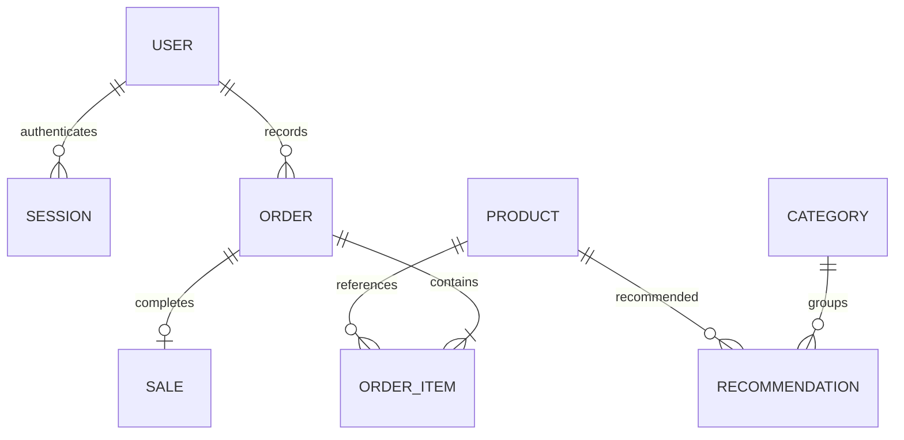

# Database PostgreSQL 17

Category adalah kategori **momen**. Relasi Product ↔ Category melalui Recommendation mengikuti class diagram PPT, bukan kategori langsung di tabel Product. Pelanggan melihat produk aktif yang direkomendasikan admin untuk kategori yang dipilih.

Nama dan harga produk di OrderItem adalah snapshot transaksi; subtotal dihitung PostgreSQL, total pesanan dihitung backend dalam satuan sen sebelum disimpan sebagai `numeric(14,2)`. Penjualan memegang total pesanan final. `UNIQUE(sales.order_id)` mencegah pencatatan ganda, `SELECT ... FOR UPDATE` mengurutkan perubahan status yang bersamaan. Referensi produk/kategori yang masih dipakai tidak dapat dihapus; menonaktifkan produk menjaga histori.

Migrasi pertama mencakup sembilan tabel termasuk tabel versi. Perubahan skema berikutnya harus berupa migrasi baru; jangan mengedit `001_initial.sql` setelah database produksi memakai versi ini. Docker menggunakan PostgreSQL 17; opsi pemindahan ke PostgreSQL terkelola tersedia lewat `DATABASE_URL` tanpa mengganti API.
